<div align="center">

  <!-- بنر هدر با موج نئونی متحرک -->
  

  <!-- متن متحرک تایپ‌شونده با استایل نئونی -->
  <a href="https://git.io/typing-svg">
    
  </a>

  <p align="center">
    <a href="https://linkedin.com/in/pejman-aslani-53a641286" target="_blank">
      
    </a>
    <a href="mailto:pejmanaslani7799@gmail.com">
      
    </a>
    
    
  </p>

</div>

---

### ⚡ پنجره وضعیت و معماری سیستم (Live Terminal)

<!-- اگر فایل neon-window.svg را در کنار README ذخیره کنید، این پنجره نئونی متحرک لود خواهد شد: -->
<p align="center">
  
</p>

---

## 👨‍💻 درباره من

```bash
pejman@system:~$ whoami
```
- 🚀 **Senior Backend Developer** با تمرکز عمیق بر اکوسیستم **PHP** و معماری سیستم‌های پربازدید (**High Concurrency**).
- 🐳 علاقه‌مند و پیاده‌ساز فرهنگ **DevOps** (اتوماسیون استقرار، مانیتورینگ، مدیریت کانتینرها و CI/CD).
- 🧩 مسلط به الگوهای طراحی (**Design Patterns**)، اصول **SOLID**، رویکرد **Clean Architecture** و **Domain-Driven Design (DDD)**.
- ⚙️ بهینه‌سازی دیتابیس‌های حجیم، کشینگ پیشرفته چندلایه‌ای و معماری رویدادمحور (**Event-Driven**).

---

## 🛠 مهارت‌های فنی و استک تخصصی (Tech Stack)

### 🔹 Backend & Architecture (Core Expertise)
<p align="left">
  
  
  
  
  
  
</p>

### 🔹 DevOps & Infrastructure
<p align="left">
  
  
  
  
  
  
</p>

### 🔹 Databases, Cache & Messaging
<p align="left">
  
  
  
  
  
</p>

### 🔹 Frontend (Proficient / Full-Stack Background)
<p align="left">
  
  
  
</p>

---
 (Synthwave / Tokyonight)

<div align="center">
  
  
</div>

<p align="center">
  
</p>

---

<div align="center">

  ## 🤝 با من در ارتباط باشید

  [](https://www.linkedin.com/in/pejman-aslani-53a641286)
  [](mailto:pejmanaslani7799@gmail.com)

  <br>

  <!-- بنر فوتر نئونی -->
  

</div>
